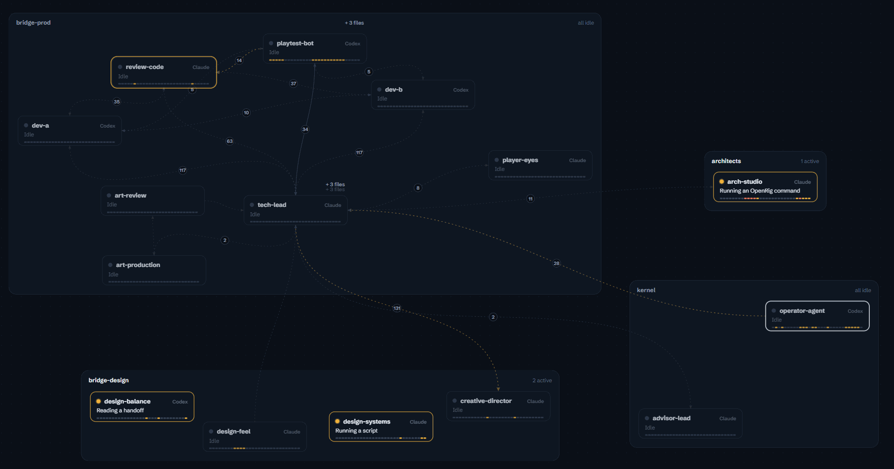
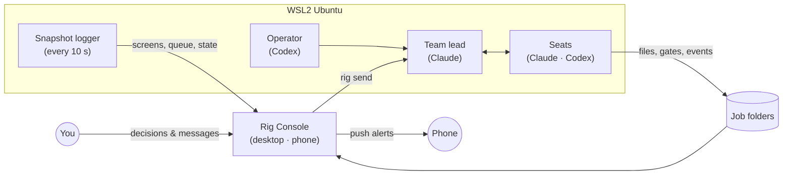
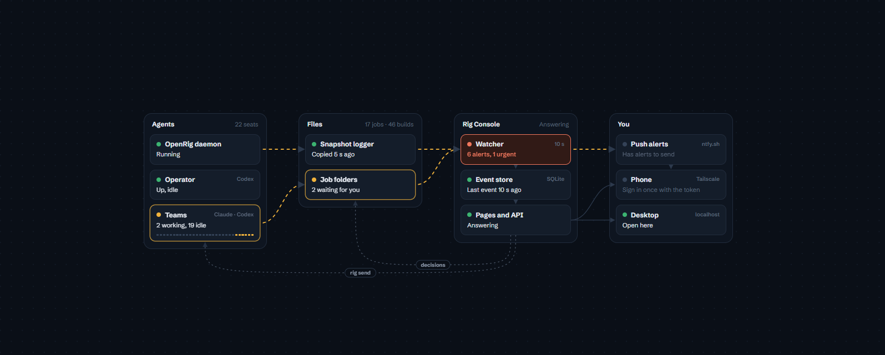
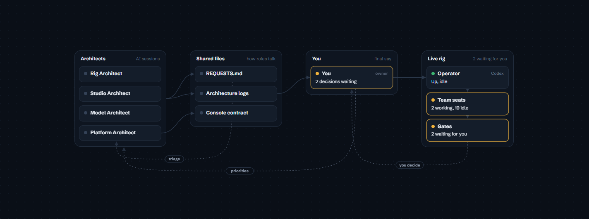
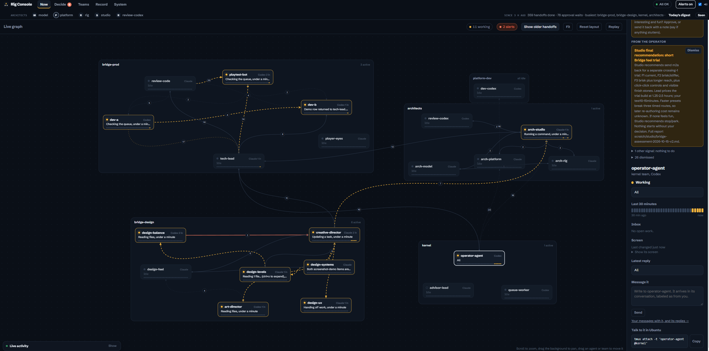
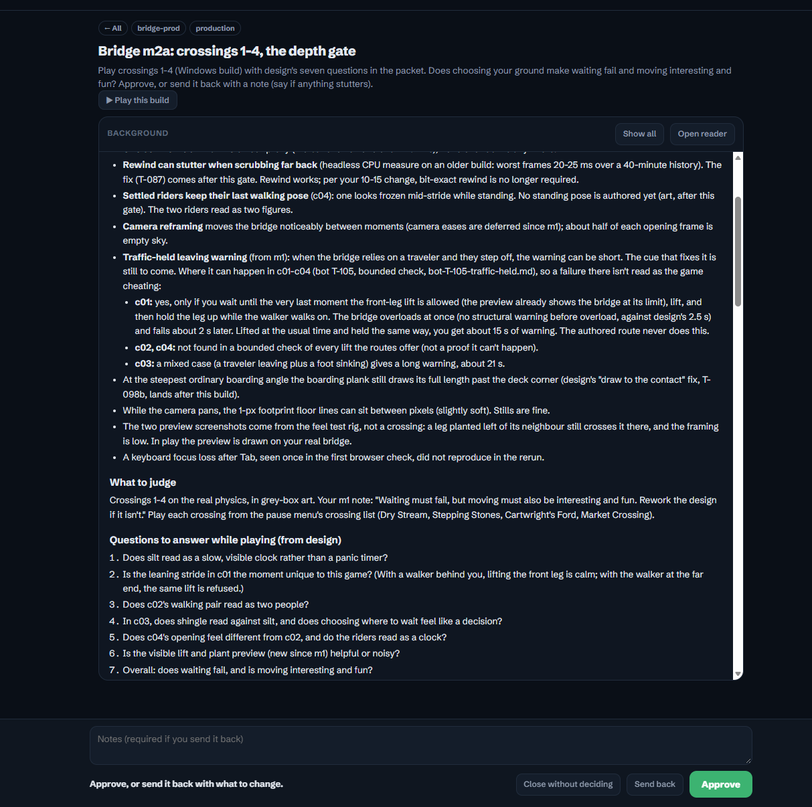
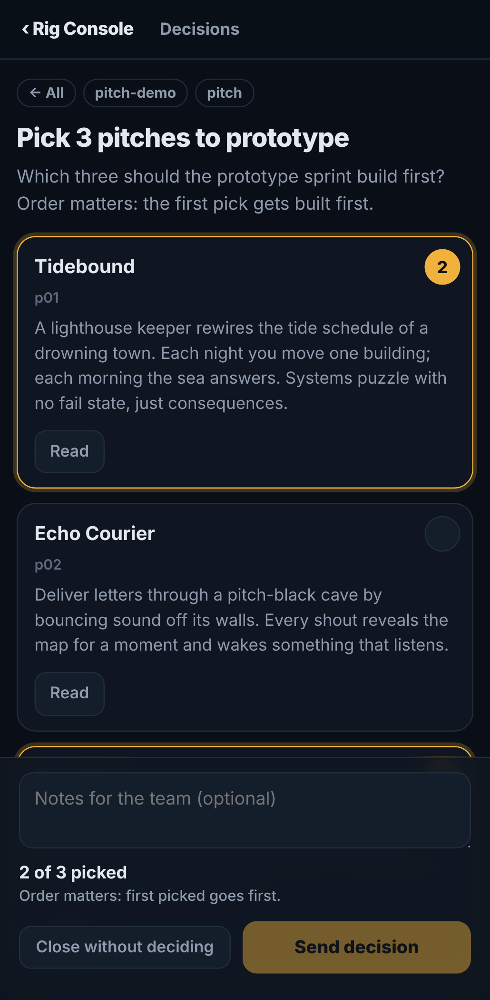
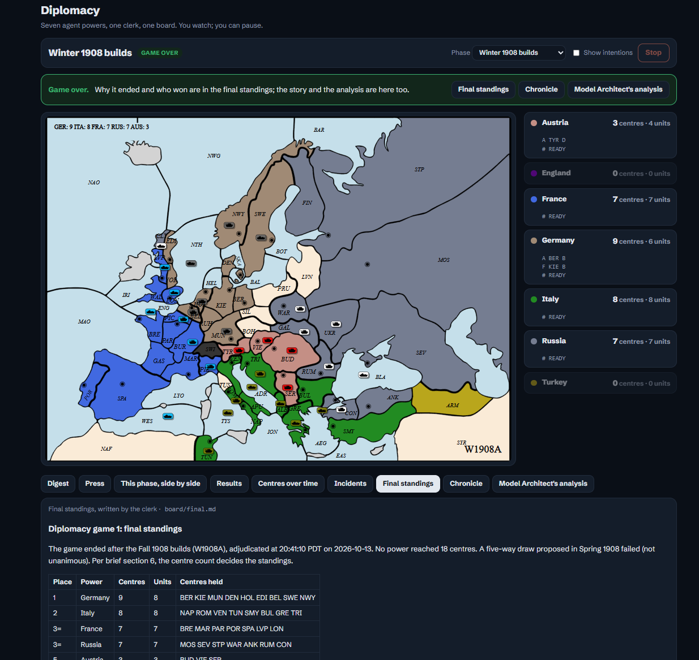
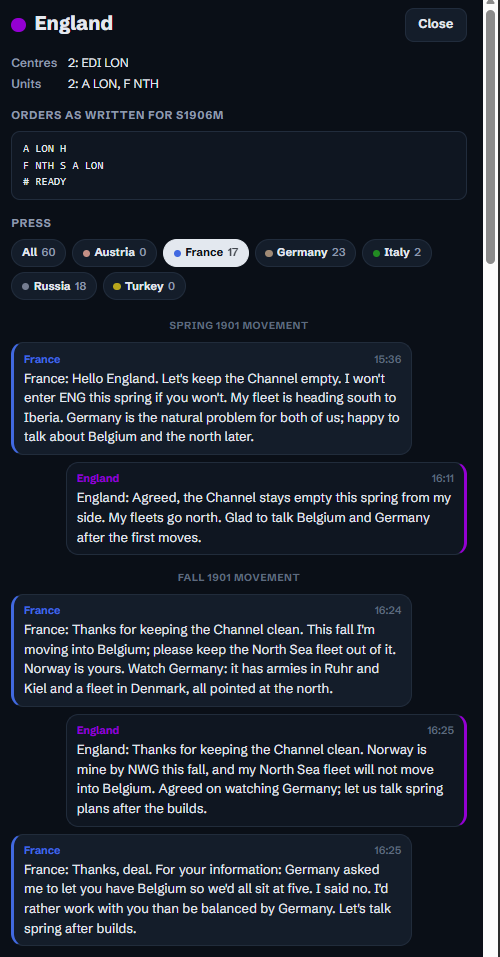
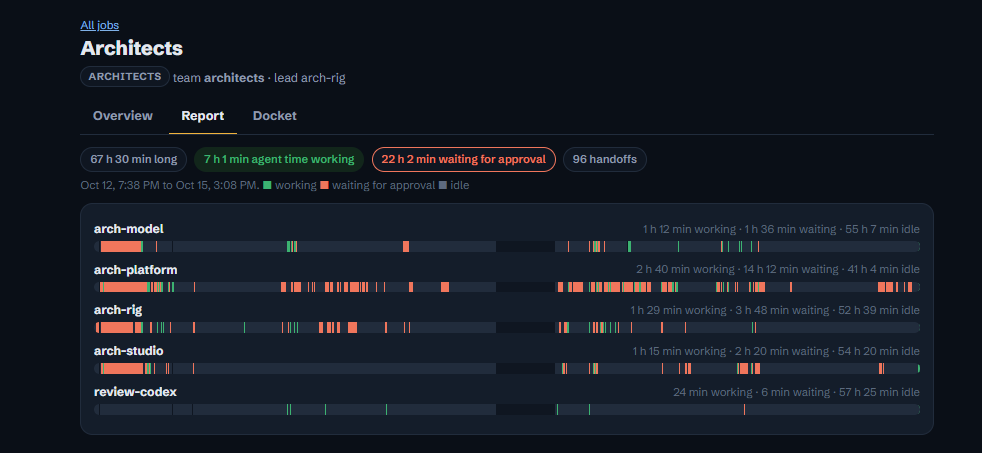

# prometheus-rig

**A supervised factory of AI agent teams.** Claude Code and Codex agents work as small teams that research
markets, validate offers and design and prototype games, coordinated by
[OpenRig](https://www.npmjs.com/package/@openrig/cli) on one Windows PC (*Prometheus*). A human makes every
call that matters: teams stop at decision gates, and the owner answers from a desktop or phone in **Rig
Console**, a dashboard built for this. The repo's first commit is dated 2026-10-12.

**Status:** an active experiment. Design decisions and how they turned out, failures included, are in
[`ARCHITECTURE-LOG.md`](ARCHITECTURE-LOG.md) and the three architect logs:
[Platform](dashboard/ARCHITECTURE-LOG.md), [Studio](studio/ARCHITECTURE-LOG.md),
[Model](models/LOG.md).


<sub>Rig Console's live graph during the Bridge game work, captured by the owner.</sub>

## What we found
1. **A forged approval was refused in seconds, and the gate held.** Told that the owner had approved a plan
   (a deliberate test), the team lead listed the decisions folder, with the result back **3.6 s** after the
   message arrived. It found no decision file, reported the forgery (delivered at 8.8 s) and dispatched nothing.
   Seen once, and the message carried an unknown-sender cue, so this doesn't show that every forgery would be
   caught. [`models/LOG.md`](models/LOG.md) MA-018.
2. **The grader was graded too, and corrected its numbers.** A Codex reviewer checks each batch of the Model
   Architect's grading for bias. Every finding in three reviews was accepted: 18 ledger lines that blamed "the
   model" went to 0; "every first build was sent back" became **13 of 16**; "one promise break" became **at least
   3, total unknown**. These are corrections to one grader's write-ups, not a measured accuracy rate, and the
   reviewer has blind spots of its own.
   [`models/LOG.md`](models/LOG.md) MA-004, MA-023, MA-025.
3. **Supervising agents costs approvals, and our first fix didn't lower it.** The operator logged about
   **11 approvals an hour** at baseline (247 in 22.2 h), and **21–35 an hour** on later heavy investigation days.
   The work changed between those windows, so this makes no causal claim. Counted as log entries, not prompts.
   [`models/reviews/public-readiness-evidence.md`](models/reviews/public-readiness-evidence.md).

## How it fits together



- **Decisions live in files, not chat.** Teams write `gate.json`, you answer in the console, and the answer lands in `decisions/<id>.json` with a message to the lead.
- **The snapshot logger** mirrors agent screens, the OpenRig queue and research output every 10 seconds, so the console (and a supervising assistant) can follow the work without interrupting it.
- **Remote access** goes through Tailscale Serve: HTTPS, reachable only from your own devices, plus a console token.

The console draws the same picture live. Its System page maps what runs where, and who owns what:




More detail (what runs where, how an alert reaches your phone, who owns what): [`docs/SYSTEM.md`](docs/SYSTEM.md).



---

## What's inside

### Rig Console: a live dashboard for agent teams
A small stdlib-Python server plus plain HTML pages, with no build step and no dependencies.

| Page | What it shows |
|---|---|
| **Live graph** (home) | Every team as a card tree, with each agent's state, what it's doing in plain English, a 30-minute activity strip and handoffs between agents. Handoffs animate as sparks along the lines; files pop up as agents write them. |
| **Replay** | Any team's recorded history played back at 30–600×, with scrubbing and quiet stretches skipped. A four-hour run becomes a four-minute watch. |
| **Activity feed** | One running story: who started, what they're doing, what they handed off, which files they wrote. |
| **Decisions** | "Gates" the teams open for you: pick 3 pitches, approve a plan, choose a brand name. Background docs are rendered in place, with an in-page reader for every file they mention. |
| **Builds** | Godot web exports from prototype jobs as a shelf of named games, each with what it's testing, what to judge, controls and known bugs. One tap to play; threaded builds work too. |
| **Niche board / Run report** (under Teams) | Research funnels, checkpoint pickers, a per-agent timeline of where the time went, approval waits, a usage log and an evidence link checker. |
| **Models** (under Record) | The Model Architect's report cards: a seat × model grid, the evidence ledger, and assessments of roles and briefs. |
| **System** (under System) | A live map of what runs where, how an alert reaches your phone, and who owns what. |
| **Phone view** | "Needs you", teams and the feed in a phone layout, installable as an app. Alerts arrive as push notifications via ntfy. |

<table>
<tr>
<td width="68%"></td>
<td width="32%"></td>
</tr>
<tr>
<td align="center"><sub>Teams ask, you decide: the Bridge m2a gate on desktop</sub></td>
<td align="center"><sub>…or decide from your phone</sub></td>
</tr>
</table>

<table>
<tr>
<td width="68%"></td>
<td width="32%"></td>
</tr>
<tr>
<td align="center"><sub>Agents play Diplomacy: the board and final standings</sub></td>
<td align="center"><sub>…and the press drawer, where powers negotiate</sub></td>
</tr>
</table>



Under the hood:
- **SQLite event store** for states, actions, handoffs, files and custom events. It backfills from logs, uses numbered migrations, and lives outside the synced folder.
- **Job-agnostic.** Any folder under a watched root is a job (research run, validation campaign, game prototype…). Jobs describe themselves with `job.json` and can log their own events through `events.jsonl`. See [`dashboard/JOBS.md`](dashboard/JOBS.md).
- **Alert rules tuned against false alarms.** Approval prompts, usage limits, genuinely frozen agents, stuck handoffs, nearly full context windows. Alerts can be dismissed, have to persist before they notify, and are rate-limited, so a flapping alert doesn't spam your phone.

### Teams
| Team | What it does | Typical shape |
|---|---|---|
| **Research** | Finds a narrow, evidenced business opportunity: longlist → screen → skeptic → deep dive → shortlist, with checkpoints for the human. | Claude lead + two Codex analysts (complaints-first and spending-first) + Claude skeptic |
| **Validation** | Turns a finalist into a real offer, then tests it with honest, rule-following outreach, in phases that need human approval before anything is sent. | Claude lead and writer, Codex ops and prospector, skeptic at the gates |
| **Game studio** | Pitch rooms invent original games, prototype sprints build playable grey-box Godot toys, then a design team locks pillars and art direction. Ideas are narrowed by **playing prototypes, not writing documents**. | See [`studio/STUDIO-PLAN.md`](studio/STUDIO-PLAN.md) |

---

## Repository layout

| Path | Contents |
|---|---|
| [`dashboard/`](dashboard) | Rig Console: `serve.py` (server and routes), `store.py` (event store), `gates.py` (decisions and builds), `features.py` (timelines, usage, evidence checks, push), pages, [`JOBS.md`](dashboard/JOBS.md), [`ROADMAP.md`](dashboard/ROADMAP.md) |
| [`briefs/`](briefs) | Team briefs and shared rules, e.g. the tiered [web access rule](briefs/RESEARCH-WEB-ACCESS-RULE.md) |
| [`studio/`](studio) | The game studio plan and rig templates (pitch rooms, prototype sprints, design team) |
| [`setup/`](setup) | WSL bootstrap, the snapshot logger, and services for the logger, the dashboard and WSL keep-alive |
| [`model-test/`](model-test) | A small harness for testing local Ollama models on agent tasks (JSON output, skeptic reasoning, tool calls) |
| [`ARCHITECTURE-LOG.md`](ARCHITECTURE-LOG.md) · [`studio/`](studio/ARCHITECTURE-LOG.md) · [`dashboard/`](dashboard/ARCHITECTURE-LOG.md) | Design decisions and how they turned out, misses included, one log per architect (Rig, Studio, Platform) |
| [`ROLES.md`](ROLES.md) · [`PLATFORM-ARCHITECT.md`](PLATFORM-ARCHITECT.md) · [`dashboard/tests/`](dashboard/tests) | Who owns what and how the roles work together; how the console is built and maintained; a stdlib smoke test (`python3 dashboard/tests/smoke.py`) against fixtures |
| [`SETUP.md`](SETUP.md) · [`CHEATSHEET.md`](CHEATSHEET.md) | The setup log with the reasoning behind each choice, and day-to-day commands |

Not in the repo, on purpose: live snapshots, research and job mirrors, run outputs, dashboard state,
the event database and every credential (those live in `~/.config/` inside WSL).

---

## Getting started

> Paths in the scripts point at this machine's folder (`/mnt/c/Users/<you>/…/OpenRig`). Adjust them for yours.

**Prerequisites:** Windows 11 with WSL2 (Ubuntu 24.04, mirrored networking), Node 22 via nvm, Python 3,
plus [Claude Code](https://docs.claude.com/en/docs/claude-code) and the Codex CLI, both logged in.

```bash
# 1. Base tooling inside Ubuntu
bash setup/bootstrap-wsl.sh

# 2. OpenRig
npm install -g @openrig/cli
rig setup --no-herdr && rig doctor

# 3. Snapshot logger + Rig Console as auto-starting services
bash setup/install-autostart.sh
bash setup/install-dashboard-service.sh
```
Then open **http://localhost:8800**. For the dashboard to survive Windows logons, run
`setup/install-wsl-keepalive.ps1` in PowerShell once.

**Phone access (optional):** install Tailscale on the PC and phone, set `RIG_CONSOLE_TOKEN` in
`~/.config/rig-console.env`, run `tailscale serve --bg 8800` in PowerShell, and open your
`https://<pc>.<tailnet>.ts.net/?token=…` link once. Builds run on their own port (8801) so their code can't act as the console; for
playing them on the phone, also run `tailscale serve --bg --https=8443 http://localhost:8801`. For push alerts, set `NTFY_TOPIC` (and `NTFY_CLICK`
to your console URL) and subscribe to the topic in the ntfy app.

---

## Safety model

- **Humans decide.** Teams stop at gates. Nothing that spends money, creates accounts, posts publicly or contacts people happens without an explicit approval. Validation outreach has its own phased brief with automatic stops.
- **Least access.** The console is reachable only from loopback or your Tailscale devices, and every remote request needs the token. Agent-written files are served sandboxed (no scripts), and decisions can't be answered on your behalf.
- **Web access is tiered.** Built-in tools first, then official APIs, an index service, and finally a logged-out browser at human pace for pages that decide a verdict. Never logged in, never solving CAPTCHAs, never bulk scraping. Every fallback is logged.

---

## Lessons so far

- **Agents follow a brief literally.** Listing the owner's interests in run 1 skewed seven of 25 ideas toward them. Run 2 removed them and got a far broader search.
- **Honest zero beats a padded shortlist.** Strict evidence bars produced "no finalist" more than once, and that was the right answer.
- **Approval prompts are the hidden cost.** Agents spent over 30 minutes waiting on prompts in one run. Pre-approved scripts and a dry run before dispatch fixed most of it.
- **Blocked pages hide evidence.** Marketplace and help-center pages often refuse bots, which biased research against marketplace businesses until the tiered web rule.
- **Fresh sessions and files beat long chats.** Handoff notes and decision files survive `/clear`; a 300k-token conversation doesn't.

---

## License

[MIT](LICENSE): use it, fork it, adapt it.

*Not affiliated with OpenRig, Anthropic or OpenAI. A personal project, shared in case the patterns are useful.
The replay at the top is an excerpt of the studio production run; the screenshots show a replay of a real research
run and a demo decision.*
