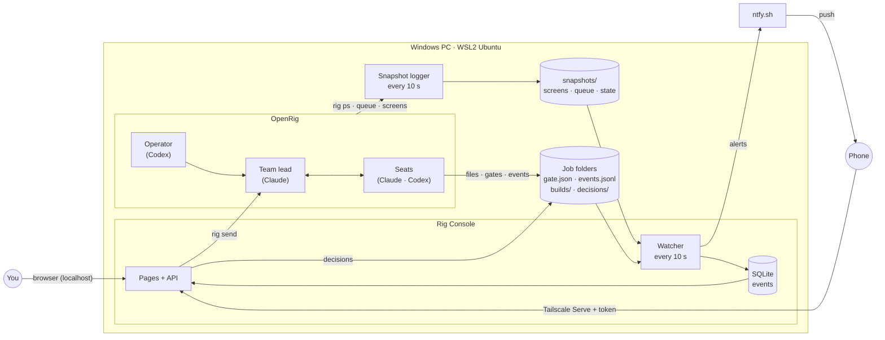
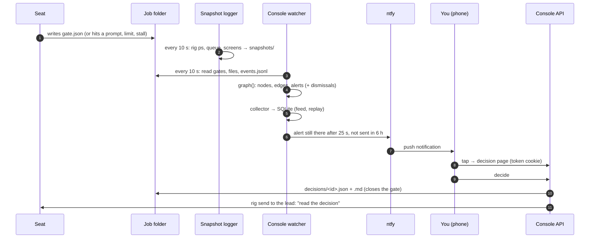
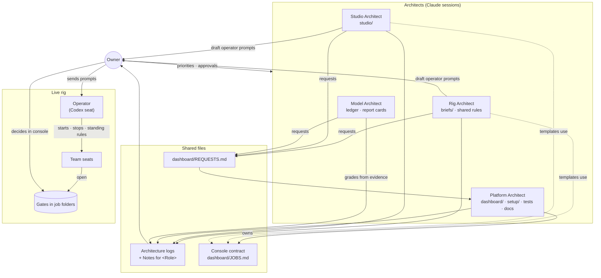

# How the system fits together

Three views of the same setup: what runs where, how a team's work reaches your phone, and who owns
what. For the short version, see the diagram in the [README](../README.md#how-it-fits-together).

## 1. What runs where

## 2. From agent work to your phone

## 3. Who owns what, and how roles talk

Every file has one owner. Roles change each other's files only by asking through the owner. Full detail
in [`ROLES.md`](../ROLES.md).

